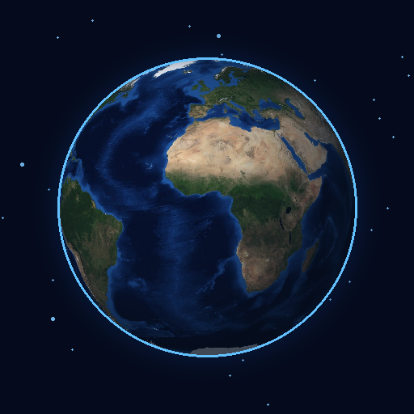

<div align="center">
  

  # Planeta Vivo

  **Um laboratório planetário interativo para experimentar diferentes futuros da Terra.**

  Godot 4 · GDScript · 3D · Android (plataforma-alvo)
</div>

---

## Sobre o projeto

**Planeta Vivo** é um jogo experimental de simulação planetária em desenvolvimento. A proposta é observar a Terra em um globo 3D realista, realizar intervenções e acompanhar consequências ambientais ao longo do tempo.

O projeto combina duas experiências: a interação direta com um planeta, inspirada em jogos como *Solar Smash*, e a observação de indicadores e eventos globais, como em *Plague Inc.*. A intenção é manter as mecânicas acessíveis, sem transformar a experiência em um jogo de estratégia excessivamente complexo.

No futuro, estão previstos modos voltados a **recuperar o equilíbrio ambiental** e **experimentar cenários destrutivos**, além de uma visualização em mapa. **Esses modos ainda não estão implementados na versão atual.**

## Estado do desenvolvimento

**Versão atual: v0.1 — primeiro protótipo jogável no editor do Godot.**

O projeto já foi executado no Godot para computador. O **Android é a plataforma prioritária**, mas a primeira exportação e os testes em aparelho físico ainda precisam ser validados.

### O que já funciona na v0.1

- Globo 3D com textura realista da superfície terrestre, camada de nuvens, atmosfera, iluminação e fundo estrelado.
- Rotação e aproximação do planeta com mouse; código inicial para gestos de toque e pinça.
- Seleção de intervenções e aplicação em pontos da superfície.
- Marcadores visuais temporários para indicar onde uma ação foi aplicada.
- Indicadores experimentais de temperatura, CO₂, biodiversidade, estabilidade e energia limpa.
- Avanço manual de um ano e reinício da simulação.
- Execução offline, sem contas, APIs, serviços remotos ou servidor próprio.

### Intervenções disponíveis

| Ação | Comportamento atual |
|---|---|
| **Meteoro** | Exibe um marcador de impacto e altera indicadores ambientais. |
| **Reflorestar** | Aumenta o indicador de biodiversidade e reduz o CO₂ no modelo experimental. |
| **Energia limpa** | Aumenta a participação de energia limpa no modelo. |
| **Aquecer** | Eleva a temperatura simulada e reduz a estabilidade. |

As ações ainda **não** produzem crateras, incêndios detalhados, mudanças permanentes na textura da Terra ou simulação regional por país.

> **Nota científica:** os valores e as relações entre os indicadores são regras simplificadas de jogo. Não representam previsões climáticas, dados em tempo real nem um modelo científico calibrado.

## Como executar no computador

### Requisitos

- [Godot Engine](https://godotengine.org/download/) **4.7.2 Standard** (GDScript, sem necessidade da edição .NET).
- Computador com suporte gráfico compatível com o renderizador **Compatibility** do Godot.

### Abrir o projeto

1. Clone o repositório com o GitHub Desktop ou baixe-o pelo botão **Code → Download ZIP**.
2. Abra o **Gerenciador de Projetos** do Godot e clique em **Importar**.
3. Selecione o arquivo `project.godot` na pasta do repositório.
4. Se o Godot solicitar atualização de versão do projeto, faça um backup e confirme a migração.
5. Aguarde a importação das texturas.
6. Pressione **F5** para executar a cena principal (`scenes/principal.tscn`).

### Controles atuais

| Ação | Computador | Android (previsto no código; ainda não validado no aparelho) |
|---|---|---|
| Girar a Terra | Arrastar com o botão esquerdo | Arrastar com um dedo |
| Aproximar/afastar | Roda do mouse | Movimento de pinça com dois dedos |
| Aplicar intervenção | Escolher a ação e clicar no planeta | Escolher a ação e tocar no planeta |
| Avançar o tempo | Botão **+ 1 ANO** | Botão na tela |
| Reiniciar | Botão **REINICIAR** | Botão na tela |

## Exportação para Android

O repositório contém `export_presets.cfg`, com uma **predefinição inicial de exportação Android**. Isso não significa que já exista um APK compilado ou testado.

Para exportar:

1. Instale os **modelos de exportação** correspondentes à sua versão do Godot, em **Editor → Gerenciar Modelos de Exportação**.
2. Configure o **JDK 17** e o **Android SDK** em **Editor → Configurações do Editor → Exportação → Android**. É possível utilizar o SDK já instalado pelo Android Studio.
3. Abra **Projeto → Exportar** e selecione a predefinição **Android**.
4. Verifique as configurações e gere um **APK de depuração** para testes.
5. Instale em um aparelho Android ou use a execução remota por USB, quando configurada.
6. Valide principalmente os gestos, o layout vertical, a legibilidade e o desempenho.

A configuração gráfica atual usa o renderizador **Compatibility**. Ela foi escolhida como ponto de partida para compatibilidade, mas o desempenho em dispositivos Android ainda não foi medido.

Consulte também a [documentação oficial de exportação para Android](https://docs.godotengine.org/en/stable/tutorials/export/exporting_for_android.html).

## Estrutura do projeto

```text
PlanetaVivo/
├── assets/                    # Texturas da Terra, nuvens, céu e ícone
├── docs/
│   └── CREDITOS.md            # Procedência e atribuições dos recursos
├── scenes/
│   └── principal.tscn         # Cena principal 3D
├── scripts/
│   ├── principal.gd           # Entrada, câmera e aplicação de ações
│   ├── terra.gd               # Rotação, nuvens e marcadores
│   ├── interface.gd           # Painéis, indicadores e botões
│   └── simulacao.gd           # Estado e regras experimentais do planeta
├── shaders/
│   └── atmosfera.gdshader     # Efeito visual da atmosfera
├── export_presets.cfg         # Configuração inicial de exportação
└── project.godot              # Configuração principal do Godot
```

Os scripts usam nomes de variáveis e funções em português sempre que possível. A lógica da simulação está separada da apresentação visual para permitir acrescentar outros modos de visualização no futuro.

## Limitações conhecidas

Esta é uma versão inicial e alguns problemas ainda são esperados:

- **Interface:** o painel inferior pode apresentar espaçamento excessivo e rótulos estreitos, com texto quebrado verticalmente.
- **Controles:** a rotação do globo ainda não é suficientemente intuitiva; a distinção entre toque e arrasto precisa ser refinada.
- **Efeitos:** impactos são representados por marcadores temporários, sem deformação física do planeta.
- **Simulação:** os indicadores são globais e ilustrativos; não há países, ciclos físicos realistas ou políticas econômicas detalhadas.
- **Progresso:** não existe ainda um sistema persistente de salvamento de partidas.
- **Android:** o comportamento em aparelhos físicos e a exportação do APK ainda estão pendentes de testes.

Se o Godot apresentar o erro de tipagem `Cannot infer the type of "marcado"`, em `scripts/interface.gd`, a variável pode ser declarada explicitamente assim:

```gdscript
var marcado: bool = chave == nova_acao
```

## Próximas etapas

O roteiro abaixo é **planejado**, não uma lista de recursos já disponíveis.

| Etapa | Objetivo |
|---|---|
| **v0.1.1 — Usabilidade** | Corrigir o painel inferior, melhorar rotação e zoom e evitar impactos acidentais durante arrastos. |
| **v0.2 — Interação visual** | Efeitos iniciais de meteoros e outras intervenções; testes práticos no Android. |
| **v0.3 — Simulação** | Melhorar as relações entre indicadores, a passagem do tempo e a apresentação de acontecimentos. |
| **v0.4 — Modos de jogo** | Introduzir experiências de Equilíbrio e Caos, com objetivos simples e reinício rápido. |
| **Futuro** | Mapa 2D alternativo, dados regionais, salvamento e efeitos de destruição mais elaborados. |

A prioridade do projeto é uma experiência **agradável de tocar, observar e experimentar**, com foco na versão para celular e sem sistemas de gerenciamento desnecessariamente complexos.

## Recursos e créditos

- **Terra:** textura derivada da coleção **Blue Marble Next Generation**, da **NASA**, com redimensionamento para uso no protótipo.
- **Nuvens e estrelas:** texturas procedurais criadas para este projeto; não representam dados meteorológicos ou astronômicos reais.
- **Engine:** [Godot Engine](https://godotengine.org/).

Detalhes das fontes e atribuições estão em [`docs/CREDITOS.md`](docs/CREDITOS.md). O projeto não é afiliado nem endossado pela NASA ou pelos criadores dos jogos citados como inspiração.

## Repositório e colaboração

Repositório: [github.com/cathcherry/PlanetaVivo](https://github.com/cathcherry/PlanetaVivo)

Para registrar modificações, edite os arquivos na pasta vinculada ao GitHub Desktop, teste a cena no Godot, crie um commit com a descrição da mudança e utilize **Push origin** para enviar ao repositório remoto.

**Licença:** ainda não foi definida uma licença de uso e redistribuição para o código e os recursos do projeto. A publicação do repositório não substitui a escolha de uma licença.
